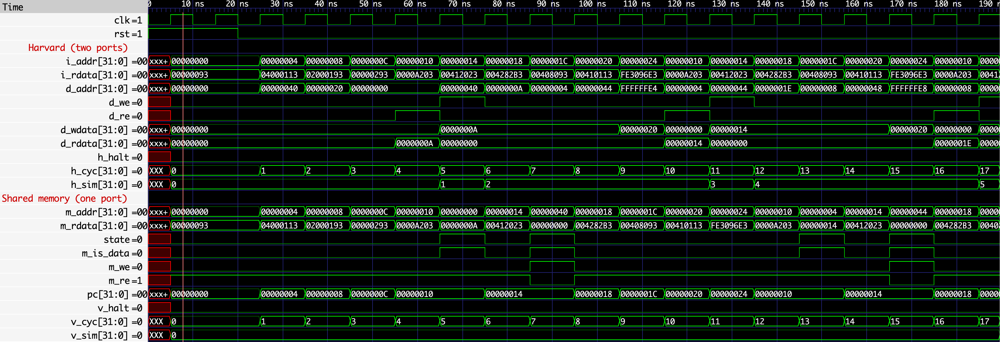
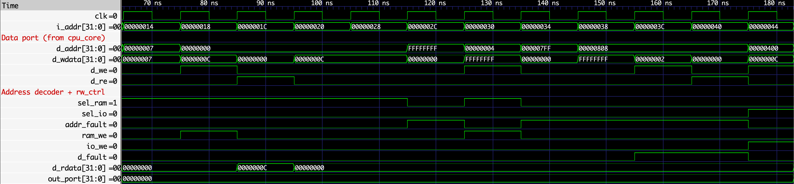

# Project 9: Instruction and Data Memory Hierarchy

**Modern Computer Architecture, Phases I and II.**

- **Phase I** built a Harvard memory organisation in Verilog (separate instruction and data
  memories), driven by a single-cycle RV32I-subset processor, and compared it with a
  shared-memory (von Neumann) baseline.
- **Phase II** replaces the ideal memories with a realistic hierarchy: one reusable direct-mapped
  cache (write-through, no-write-allocate, optional write buffer) used as I-cache, D-cache or
  unified cache, a shared lower-level memory with latency L, and an arbiter. It compares a
  **modified Harvard** system (split caches over one memory) with a **unified cache** of the same
  capacity and with **no cache**.

Final report: [report/main.pdf](report/main.pdf). The Phase I report is kept in
[report/phase1/](report/phase1/).

## Team

| Member | Name / GitHub | Phase I | Phase II | Owns (Phase II) |
|---|---|---|---|---|
| Member 1 | Yashpal (`@Yashpal-2004`) | Harvard memory core | cache and shared memory | `rtl/mem/cache.v`, `rtl/mem/main_mem.v` |
| Member 2 | Anshika (`@anshika292005`) | processor and integration | ISA extension, stall interface, modified-Harvard top, report lead | `rtl/core/`, `rtl/harvard_top.v`, `rtl/mh_top.v`, `README.md` |
| Member 3 | Ankit (`@Ankit35027`) | baseline and metrics | baseline core, arbiter, counters, single-bus top, synthesis | `rtl/baseline/`, `rtl/common/`, `results/synth2/`, `results/phase2/README.md` |
| Member 4 | Samriddhi (`@samriddhi-techy`) | verification and programs | assembler, golden model, programs, testbenches, sweep, figures | `tb/`, `programs/`, `tools/`, `sim/` |
| Member 5 | Ayush | report, video, repository lead | (not part of Phase II) | |

The Phase II file ownership and the commit plan are in
[docs/phase2_work_split.md](docs/phase2_work_split.md). Interview preparation is in
[docs/phase2_interview_prep.md](docs/phase2_interview_prep.md).

## Block diagram (Phase II)

```
  (a) Modified Harvard: mh_top                         (b) Single bus: vnc_top

  +----------+ i_addr  +---------+                     +-------------+        +----------------+
  |          |-------->| I-cache |---+                 | cpu_core_vn |------->| unified cache  |---+
  | cpu_core |<--------| N lines |   |   +---------+   | FETCH / MEM |<-------| 2N lines       |   |
  | single   | i_ready +---------+   +-->|         |   +-------------+ m_ready| (or uncached)  |   |
  | cycle    |                           | arbiter |         |                +----------------+   |
  |          | d_addr  +---------+ RAM   | I > D   |         +--> decoder: out_port / invalid      |
  |          |-------->| decoder |---+   | no pre- |              addresses bypass the cache       |
  |          |<--------| rw_ctrl |   |   | emption |                                               |
  +----------+ d_ready +---------+   v   +---------+                 +---------------------------+ |
                    out_port  +---------+    |                       | main_mem: code 0x000-3FF, |<+
                              | D-cache |----+--> one port --------->| data 0x400-7FF, latency L |
                              | N lines |                            +---------------------------+
                              | + wbuf  |       (the same main_mem in both systems)
                              +---------+
```

## Memory map

| Byte address (data space) | Region |
|---|---|
| `0x000`-`0x3FF` | data RAM, 256 words (physical `0x400`-`0x7FF` in `main_mem`) |
| `0x400` | `out_port` register (write-only, reads 0), never cached |
| anything else | invalid: write ignored, read returns 0, `d_fault` = 1, never cached |

Code occupies physical `0x000`-`0x3FF` (256 words).

## Instruction set

- Phase I: ADD, SUB, AND, OR, ADDI, LW, SW, BEQ, BNE, EBREAK.
- Phase II adds: XOR, SLT, SLL, SRL, XORI, SLTI, SLLI, SRLI, BLT, BGE, JAL, JALR, LUI
  (standard RV32I encodings).

Both cores also have a stall interface (`i_ready`/`d_ready`, `m_ready`). The Phase I tops tie it
to 1, and their cycle counts are unchanged.

## Running everything

Requirements: Icarus Verilog (`iverilog`, `vvp`), Python 3, Yosys (synthesis), tectonic or
pdfLaTeX (report), and GTKWave or [Surfer](https://surfer-project.org/) for waveforms.

```sh
cd sim
make all        # Phase I + Phase II regression, logs in ../results/logs/

# Phase I
make asm        # assemble programs/*.s (+ assembler self-test, 29 encodings)
make unit       # unit tests: addr_decoder, instr_mem, data_mem, harvard_mem
make harvard    # every program on the ideal Harvard system
make vn         # every program on the ideal shared-memory baseline
make compare    # both side by side (comparison table)
make figure     # Phase I waveform figure for the report

# Phase II
make iss        # golden-model self-test
make cache      # cache unit test (41 checks)
make mutate     # shows tb_cache fails on three deliberately broken RTL copies
make system     # every program on all five systems (L = 1, 8; write buffer off/on)
make sweep      # 528 runs: programs x L {1..16} x lines {1..32} x wbuf, checked against the ISS
make figure2    # Phase II waveform figure from a real VCD
make waves2     # open that VCD

# synthesis and report (from the repository root)
sh results/synth2/run_synth.sh    # Yosys area of every Phase II design
sh results/synth2/loop_demo.sh    # timing-rule demonstration (logic loops)
cd report && tectonic main.tex
```

Every testbench is self-checking and ends with `PASS` or `FAIL`.

## Repository layout

```
rtl/mem/        instr_mem, data_mem, addr_decoder, rw_ctrl, harvard_mem   (Phase I)
                cache, main_mem                                           (Phase II)
rtl/core/       pc_reg, regfile, alu, imm_gen, control, cpu_core
rtl/common/     perf_counters (Phase I), event_counters, arbiter (Phase II)
rtl/baseline/   shared_mem, cpu_core_vn, vn_top (Phase I), vnc_top (Phase II)
rtl/harvard_top.v  ideal Harvard system;  rtl/mh_top.v  modified Harvard system
tb/             unit, system and comparison testbenches; tb_cache, tb_system (Phase II)
programs/       basic, array_sum, memcopy, count_loop, bubble_sort, subroutine, transpose, isa_test
tools/          asm.py, iss.py (golden model), sweep.py, area_table.py, vcd2tikz.py, mutate_cache.sh
sim/Makefile    build and run targets
results/        Phase I comparison, synth, fmax; phase2/ (sweep CSV, summary), synth2/ (area), logs/
report/         final IEEE report: main.tex + sections/ (one file per owner), figures/, data/ (generated)
docs/           Phase II work split and interview preparation
```

## Results

### Phase I (ideal memories)

| Program | LW/SW % | Harvard CPI | Baseline CPI | Speed-up |
|---|---|---|---|---|
| basic      | 36.8% | 1.00 | 1.37 | 1.37x |
| array_sum  | 26.3% | 1.00 | 1.26 | 1.26x |
| memcopy    | 31.5% | 1.00 | 1.31 | 1.31x |
| count_loop |  1.6% | 1.00 | 1.02 | 1.02x |

Phase I Fmax (Lattice ECP5): Harvard 43.62 MHz, baseline 37.36 MHz. Details in
[results/comparison.md](results/comparison.md).

### Phase II (memory hierarchy)

Suite CPI over the eight programs, 4-word lines, 8 lines per split cache (16 unified), write
buffer on. Generated by `make sweep`; full tables in
[results/phase2/summary.md](results/phase2/summary.md).

| Latency L | Ideal Harvard | Modified Harvard | Unified cache | No cache |
|---|---|---|---|---|
| 1  | 1.000 | 1.055 | 1.393 | 1.238 |
| 2  | 1.000 | 1.115 | 1.558 | 2.472 |
| 4  | 1.000 | 1.280 | 1.909 | 4.940 |
| 8  | 1.000 | 1.685 | 2.717 | 9.875 |
| 16 | 1.000 | 2.687 | 4.535 | 19.747 |

- The split caches win because they keep two accesses per cycle and keep code and data apart.
  Most unified misses are code/data conflict misses: moving the data from `0x400` to `0x480`
  improves the unified CPI at L = 8 from 2.72 to 1.87.
- The unified cache wins when the code is bigger than the I-cache (`subroutine`) or when the
  caches are tiny (1 line each).
- The write buffer removes 15% of the split design's cycles.
- The modified Harvard design synthesises with no combinational loop. Area is in
  [results/synth2/area.md](results/synth2/area.md).

### Waveforms

- Phase I (`make waves PROG=memcopy`): Harvard raises `d_re`/`d_we` in the same cycle as the fetch; the
  baseline spends an extra cycle with `state` = MEM for every LW/SW.

  
- Phase I data-side control (`basic`): SW/LW to the invalid address `0x808` raise
  `addr_fault`/`d_fault` while `ram_we` stays 0.

  
- Phase II (`make waves2`): `memcopy` on the modified Harvard system, L = 4. The report's Fig. 6
  shows an I-miss, a D-miss, a buffered store draining while the core runs, and an I-miss that
  waits for the drain (no pre-emption).

## Report and video

- Final report: [report/main.pdf](report/main.pdf); Phase I report: [report/phase1/main_phase1.pdf](report/phase1/main_phase1.pdf)
- Phase I prototype video: [Google Drive Folder](https://drive.google.com/drive/folders/1gFUfU14wTAQAbcvC8pDPiQS0-IFScr1h?usp=drive_link)
